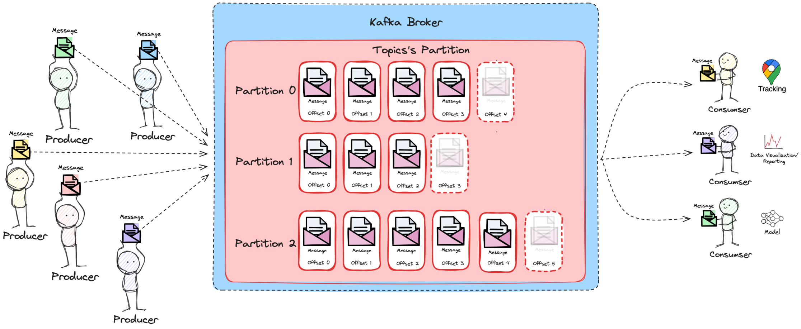
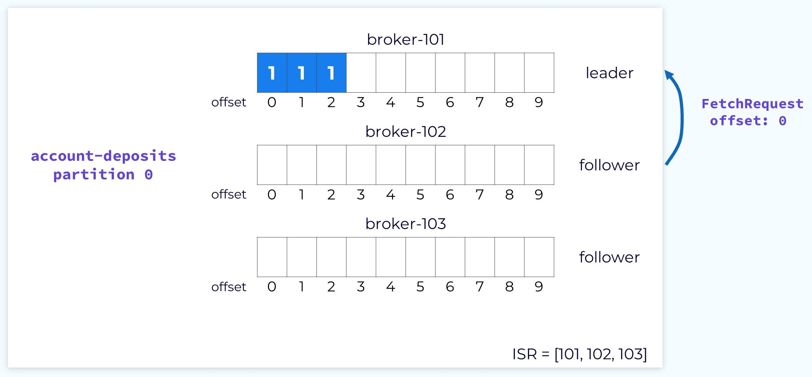
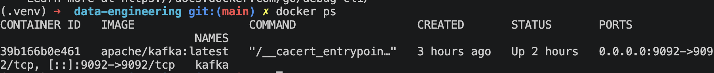
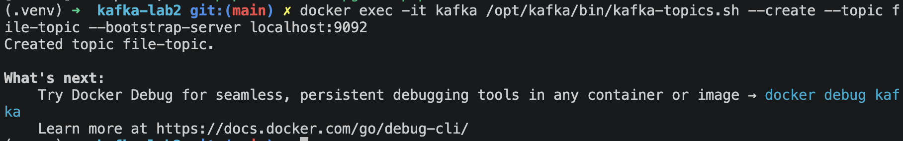
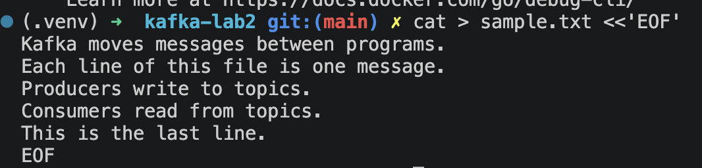
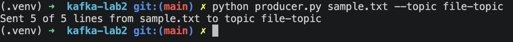
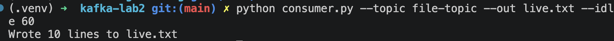
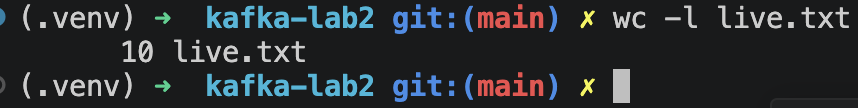

# Kafka Lab 2: Custom Python Producer and Consumer to Transfer Text Files

## 1. Lab Overview

**Objective:** Build a custom Kafka producer and consumer using Python to transfer text files through Kafka.

In this lab, I learned how to:
- Install and use the Confluent Kafka Python library.
- Create a Python producer to read a text file and send its lines to a Kafka topic.
- Create a Python consumer to receive Kafka messages and write them into a new text file.
- Verify that the original and received files are identical.
- Test real-time message transfer.
- Add line numbers to messages.

## 2. Full Architecture of Apache Kafka

### 2.1 What is Apache Kafka?

Apache Kafka is a distributed publish-subscribe messaging system. It a tool that helps different applications communicate with each other by sending and receiving messages without needing to connect directly to each other.

For example:
When a customer buys something:
1. The customer places an order.
2. The application needs to save the order.
3. The warehouse needs to know about the order.
4. The payment service needs to process the payment.
5. The email service needs to send a confirmation.

Kafka works like a messenger between applications:
- Shopping application sends a message to Kafka.
- Kafka stores the message.
- Other applications read the message from Kafka.

### 2.2 What are the main Kafka components?


**Architecture flow:**

1. **Producers** - an application that sends messages to Kafka. **Producer = Message sender**

Its responsibilities:
- Connect to a Kafka broker.
- Select a topic.
- Create messages.
- Send messages to Kafka.

2. **Broker** - Kafka server that receives messages and stores them in topics.
In Kafka, one or more brokers work together as a ****Kafka cluster**.

Benefits:
- Scalability.
- Fault tolerance.
- Distribution of data.
- High availability.

**The lab example:**

We use a Kafka broker running inside a Docker container named `kafka`.

3. **Topics** - a place where Kafka organizes messages and contain one or more partitions.

Examples:
- `file-topic`
- `orders`
- `payments`
- `user-events`

4. **Partition** - a smaller part of a topic.

They help Kafka:
- Process messages faster.
- Handle more messages.
- Work across multiple servers.
- Allow parallel reading by Consumers.

**The lab example:**

The `producer.py` script reads `sample.txt` and sends every line as an individual message to the `file-topic` topic.

5. Offset - the position of a message inside a partition

For example:

| Message | Offset |
|---|---:|
| First message | 0 |
| Second message | 1 |
| Third message | 2 |
| Fourth message | 3 |
| Fifth message | 4 |



4. Consumers subscribe to topics.
5. Consumers read messages from Kafka using offsets. **Consumer = Message reader**

Its responsibilities:
- Connect to Kafka.
- Subscribe to one or more topics.
- Read messages.
- Process or save received messages.

**The lab example:**

The `consumer.py` script reads messages from `file-topic` and writes them into `received.txt`.

6. Kafka manages metadata and cluster coordination through KRaft in modern Kafka deployments.

### 2.3 Zookeeper and KRaft

- ZooKeeper: Older Kafka architecture used ZooKeeper to manage cluster information.

- KRaft: Modern Kafka architecture uses its own built-in system to manage cluster metadata, without ZooKeeper.
The broker and controller roles run in the same Kafka process


## 3. Replication

Replication means creating copies of partitions across different Kafka brokers.

Its purpose is to protect data if a broker fails.

Important terms:
- **Leader replica:** Handles reads and writes for a partition.
- **Follower replica:** Copies data from the leader.
- **Replication factor:** Number of copies of a partition.




## 4 How Kafka Stores Messages

Kafka stores messages in an ****append-only log** inside each partition.
This means new messages are added to the end of the partition rather than replacing existing messages.

- Append means adding something to the end.
- Only means we don't normally change or replace existing messages.
- Log means an ordered list of records.

Example:

```text
Topic: file-topic
Partition: 0

Offset 0  -> First line
Offset 1  -> Second line
Offset 2  -> Third line
Offset 3  -> Fourth line
Offset 4  -> Fifth line
```


## 5 Message Keys

A Kafka message can contain:
- Key
- Value
- Timestamp
- Headers

This means messages from the same file have the same key.

With the default key-based partitioning, messages with the same key are normally sent to the same partition. This helps preserve their order within that partition.

## 6 Kafka Architecture in My Practical Lab

My practical lab uses a simplified Kafka architecture:

```text
+----------------------+
|      sample.txt      |
|                      |
|  Five lines of text  |
+----------+-----------+
           |
           v
+----------------------+
|    producer.py       |
|                      |
|  Python Producer     |
+----------+-----------+
           |
           | localhost:9092
           v
+----------------------+
|   Kafka Docker       |
|                      |
|   Broker + KRaft     |
|                      |
|   Topic: file-topic  |
|                      |
|   Partition: 0       |
+----------+-----------+
           |
           v
+----------------------+
|    consumer.py       |
|                      |
|  Python Consumer     |
+----------+-----------+
           |
           v
+----------------------+
|     received.txt     |
|                      |
|  Received messages   |
+----------------------+
```


## 7. Part 1: Setup

### Step 1: Check Kafka container

Command:

```bash
docker ps
```

**Explanation:**

This command displays the Docker containers that are currently running. I checked that my Kafka container was running before starting the lab.



### Step 2: Check Python version

Command:

```bash
python3 --version
```

**Result:**

```text
Python 3.13.4
```

### Step 3: Install the Kafka Python library

Command:

```bash
pip install confluent-kafka
```

**Explanation:**

The `confluent-kafka` library allows Python applications to communicate with Kafka brokers.

**Result:**

```text
Successfully installed confluent-kafka-2.16.2
```

### Step 4: Create Kafka topic

Command:

```bash
docker exec -it kafka /opt/kafka/bin/kafka-topics.sh --create --topic file-topic --bootstrap-server localhost:9092
```

**Explanation:**

A Kafka topic is a logical channel where messages are stored. The producer sends messages to `file-topic`, and the consumer reads messages from it.

**Result:**




### Step 5: Create sample text file

Command:

```bash
cat > sample.txt <<'EOF'
Kafka moves messages between programs.
Each line of this file is one message.
Producers write to topics.
Consumers read from topics.
This is the last line.
EOF
```

**Explanation:**

Created a sample text file containing five lines. Each line will become a separate Kafka message.

To check the contents:

```bash
cat sample.txt
```




## 6. Part 2: Create a Python Producer

### Objective

The producer reads a text file line by line and sends each line as an individual message to a Kafka topic.

### File: producer.py

The producer:
1. Connects to Kafka at `localhost:9092`.
2. Reads the input file.
3. Uses the filename as the Kafka message key.
4. Sends each line to the selected topic.
5. Waits for message delivery confirmation.

**Important concepts:**

- `Producer`: creates a Kafka producer.
- `produce()`: sends a message to Kafka.
- `poll()`: allows delivery callbacks to execute.
- `flush()`: waits until queued messages have been delivered.
- `key`: identifies the source filename.

### Run the producer

Command:

```bash
python producer.py sample.txt --topic file-topic
```

**Result:**

```text
Sent 5 of 5 lines from sample.txt to topic file-topic
```

All five lines were successfully sent to Kafka.



## 7. Part 3: Create a Python Consumer

### Objective

The consumer reads messages from a Kafka topic and writes them into a new text file.

### File: consumer.py

The consumer:
1. Connects to Kafka.
2. Subscribes to `file-topic`.
3. Reads messages from the topic.
4. Decodes messages from UTF-8.
5. Writes the messages into `received.txt`.
6. Stops after 10 seconds without receiving new messages.

**Important concepts:**

- `Consumer`: creates a Kafka consumer.
- `subscribe()`: subscribes to a topic.
- `poll()`: waits for messages.
- `auto.offset.reset`: determines where to start reading when no previous offset exists.
- `group.id`: identifies the consumer group.
- `close()`: closes the consumer connection.

### Run the consumer

Command:

```bash
python consumer.py --topic file-topic --out received.txt
```

**Result:**

```text
Wrote 5 lines to received.txt
```

## 8. Part 4: Verify File Transfer

### Objective

Check whether the original file and the received file contain exactly the same content.

Command:

```bash
diff -u sample.txt received.txt
```

**Explanation:**

The `diff` command compares two files line by line.

- If differences are found, they are displayed.
- If no output appears, the files are identical.

**Result:** No differences were found. The file transfer was successful.

## 9. Live Test: Real-Time Message Transfer

### Objective

Test how a Kafka consumer receives messages while it is already running and waiting.

Two Terminal windows were used.

**Terminal A — Start the consumer:**

```bash
python consumer.py --topic file-topic --out live.txt --idle 60
```

The consumer waits for messages for up to 60 seconds after the last message.

**Terminal B — Start the producer:**

```bash
python producer.py sample.txt --topic file-topic
```

The producer sends another five messages to Kafka.

### Expected result

The consumer reads:
- The first five messages already stored in Kafka.
- The five new messages sent by the producer.

Total: 10 messages.



### Verify the result

Command:

```bash
wc -l live.txt
```

**Result:**

```text
10 live.txt
```

This confirms that the consumer received and saved ten lines.



