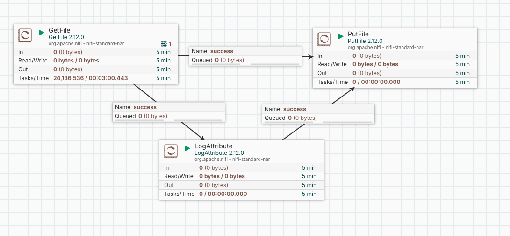

# Apache NiFi – My First File Processing Pipeline

## 1. Goal

The goal of this exercise was to create a simple data flow in Apache NiFi using three processors:

**GetFile → LogAttribute → PutFile**

The pipeline reads a text file, logs information about it, and saves it into another folder.

## 2. Environment

- Operating System: macOS (Apple M1)
- Docker Desktop
- Apache NiFi 2.12.0
- Docker container name: `nifi`

NiFi was accessed through:

`https://localhost:8443/nifi`

## 3. Docker Setup

We started the NiFi container using:

```bash
docker run -d \
  --name nifi \
  -p 8443:8443 \
  apache/nifi:2.12.0
```

We created two folders inside the container:

```bash
docker exec nifi mkdir -p /tmp/nifi-input /tmp/nifi-output
```

- `/tmp/nifi-input` – input folder.
- `/tmp/nifi-output` – output folder.

We copied our sample file from the Mac into the Docker container:

```bash
docker cp ~/Downloads/sample.txt nifi:/tmp/nifi-input/sample.txt
```

## 4. Sample File

We created a text file called `sample.txt` containing:

```text
Hello! This is a sample file for testing Apache NiFi.
GetFile can read this file and PutFile can save a copy to another folder.
```

## 5. Pipeline Architecture

Our pipeline consists of three processors:

```text
GetFile → LogAttribute → PutFile
```

### GetFile

**Purpose:** Reads files from the input directory and creates FlowFiles.

Configuration:

| Property | Value |
|---|---|
| Input Directory | `/tmp/nifi-input` |
| Keep Source File | `true` |
| Polling Interval | `30 sec` |

We set Keep Source File to `true` so the original file remains in the input folder.

### LogAttribute

**Purpose:** Logs information about a FlowFile.

Configuration:

| Property | Value |
|---|---|
| Log Payload | `false` |

LogAttribute helps us inspect FlowFile information, such as its filename, size, and UUID.

We set Log Payload to false because we only wanted to log metadata, not the file contents.

### PutFile

**Purpose:** Writes the FlowFile content into the output directory.

Configuration:

| Property | Value |
|---|---|
| Directory | `/tmp/nifi-output` |
| Create Missing Directories | `true` |
| Conflict Resolution Strategy | `fail` |

## 6. Connections and Relationships

We connected the processors using their `success` relationships:

- GetFile → LogAttribute
- LogAttribute → PutFile

The `success` relationship transfers successfully processed FlowFiles to the next processor.

For this simple exercise, we configured the remaining relationships to terminate.

## 7. Testing the Pipeline

We started all three processors in NiFi.

The processors appeared green, which indicated that they were running.

We checked the output directory using:

```bash
docker exec nifi ls -l /tmp/nifi-output
```

The result was:

```text
total 4
-rw-r--r-- 1 nifi nifi 128 Nov 25 11:29 sample.txt
```

This confirmed that `sample.txt` was successfully saved in the output directory.

We also copied the output file back to the Mac Desktop:

```bash
docker cp nifi:/tmp/nifi-output/sample.txt ~/Desktop/sample.txt
```

We opened the file on the Mac and verified its contents.

## 8. Screenshot of the NiFi Pipeline




